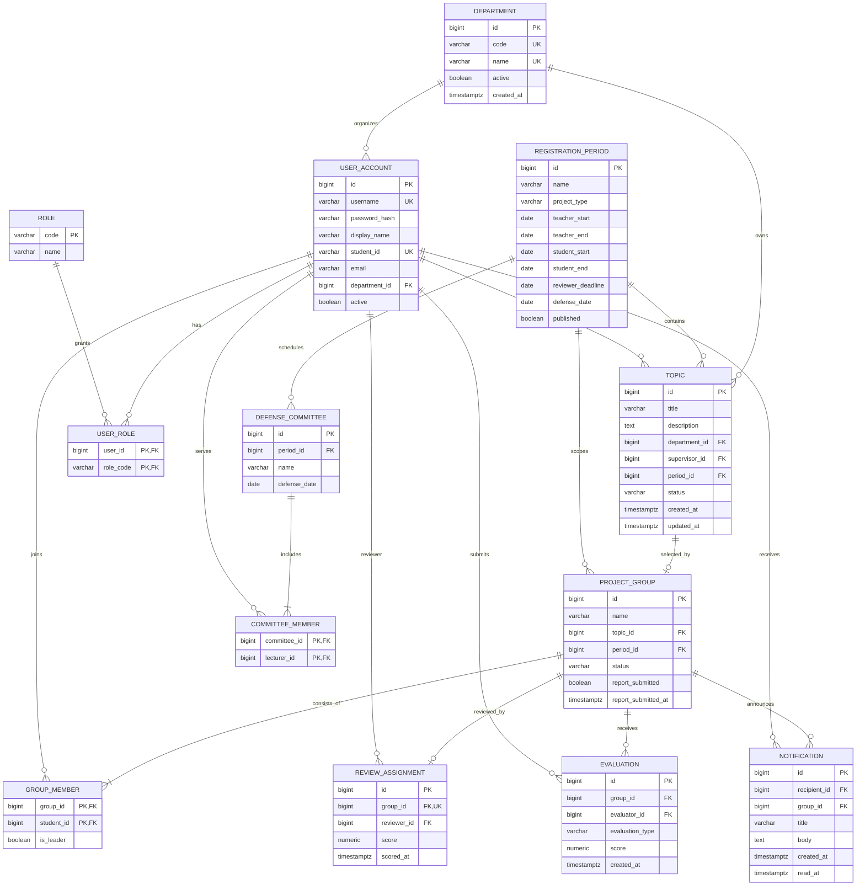

# ERD và từ điển dữ liệu

## Sơ đồ thực thể - quan hệ

## Từ điển bảng/cột

| Bảng | Cột | Kiểu / ràng buộc | Ý nghĩa |
|---|---|---|---|
| `department` | `id` | BIGINT PK identity | Khóa bộ môn. |
| | `code` | VARCHAR(30) UNIQUE NOT NULL | Mã bộ môn duy nhất. |
| | `name` | VARCHAR(150) UNIQUE NOT NULL | Tên bộ môn. |
| | `active`, `created_at` | BOOLEAN NOT NULL, TIMESTAMPTZ NOT NULL | Trạng thái sử dụng và thời điểm tạo. |
| `user_account` | `id` | BIGINT PK identity | Khóa tài khoản. |
| | `username` | VARCHAR(80) UNIQUE NOT NULL | Tên đăng nhập. |
| | `password_hash` | VARCHAR(100) NOT NULL | BCrypt hash; tuyệt đối không lưu mật khẩu gốc. |
| | `display_name` | VARCHAR(150) NOT NULL | Họ tên hiển thị. |
| | `student_id` | VARCHAR(30) UNIQUE NULL | MSSV; NULL với người không phải SV. |
| | `email` | VARCHAR(254) NULL | Email liên lạc tùy chọn. |
| | `department_id` | BIGINT FK -> `department.id` NULL | Bộ môn công tác. |
| | `active` | BOOLEAN NOT NULL | Khóa/mở tài khoản. |
| `role` | `code` | VARCHAR(30) PK | ADMIN, DEPARTMENT_HEAD, TEACHER, SUPERVISOR, REVIEWER, COUNCIL, STUDENT. |
| | `name` | VARCHAR(80) NOT NULL | Nhãn vai trò. |
| `user_role` | `user_id` | BIGINT PK/FK -> `user_account.id` | Người dùng được gán vai trò. |
| | `role_code` | VARCHAR(30) PK/FK -> `role.code` | Vai trò được cấp; unique cặp user/role. |
| `registration_period` | `id` | BIGINT PK identity | Khóa đợt đăng ký. |
| | `name`, `project_type` | VARCHAR(150), VARCHAR(30) NOT NULL | Tên và loại đợt. |
| | `teacher_start`, `teacher_end` | DATE NOT NULL | Cửa sổ nhận đề xuất đề tài. |
| | `student_start`, `student_end` | DATE NOT NULL | Cửa sổ đăng ký nhóm của SV. |
| | `reviewer_deadline`, `defense_date` | DATE NULL | Hạn phản biện và ngày hội đồng. |
| | `published` | BOOLEAN NOT NULL | Đợt được công bố/mở. |
| `topic` | `id` | BIGINT PK identity | Khóa đề tài. |
| | `title`, `description` | VARCHAR(250), TEXT NOT NULL | Tên và nội dung đề tài. |
| | `department_id` | BIGINT FK -> `department.id` | Bộ môn quản lý. |
| | `supervisor_id` | BIGINT FK -> `user_account.id` | GVHD chính. |
| | `period_id` | BIGINT FK -> `registration_period.id` | Đợt chứa đề tài. |
| | `status` | VARCHAR(30) NOT NULL | DRAFT, APPROVED, REJECTED, PUBLISHED, ASSIGNED, COMPLETED. |
| | `created_at`, `updated_at` | TIMESTAMPTZ NOT NULL | Dấu thời gian. |
| `project_group` | `id` | BIGINT PK identity | Khóa nhóm. |
| | `name` | VARCHAR(80) NOT NULL | Tên nhóm. |
| | `topic_id` | BIGINT FK -> `topic.id` UNIQUE | Mỗi đề tài nhận tối đa một nhóm. |
| | `period_id` | BIGINT FK -> `registration_period.id` | Đợt đăng ký; phải trùng đợt của đề tài. |
| | `status` | VARCHAR(30) NOT NULL | Trạng thái duyệt, báo cáo, đánh giá, công bố. |
| | `report_submitted`, `report_submitted_at` | BOOLEAN, TIMESTAMPTZ NULL | Trạng thái và thời điểm nhóm trưởng nộp báo cáo. |
| `group_member` | `group_id` | BIGINT PK/FK -> `project_group.id` | Nhóm của SV. |
| | `student_id` | BIGINT PK/FK -> `user_account.id` | Thành viên; unique theo SV/đợt (triển khai bằng cột `period_id` hoặc index tương ứng). |
| | `is_leader` | BOOLEAN NOT NULL | Đánh dấu nhóm trưởng; mỗi nhóm đúng một leader (partial unique index). |
| `review_assignment` | `id` | BIGINT PK identity | Khóa phân công phản biện. |
| | `group_id` | BIGINT FK -> `project_group.id` UNIQUE | Nhóm được phản biện. |
| | `reviewer_id` | BIGINT FK -> `user_account.id` | GVPB được phân công. |
| | `score`, `scored_at` | NUMERIC(4,2) CHECK 0..10 NULL | Điểm và thời điểm nhập. |
| `defense_committee` | `id` | BIGINT PK identity | Khóa hội đồng. |
| | `period_id` | BIGINT FK -> `registration_period.id` | Đợt bảo vệ. |
| | `name`, `defense_date` | VARCHAR(120), DATE | Tên và ngày họp. |
| `committee_member` | `committee_id` | BIGINT PK/FK -> `defense_committee.id` | Hội đồng. |
| | `lecturer_id` | BIGINT PK/FK -> `user_account.id` | Thành viên giảng viên duy nhất trong hội đồng. |
| `evaluation` | `id` | BIGINT PK identity | Khóa phiếu điểm. |
| | `group_id` | BIGINT FK -> `project_group.id` | Nhóm được chấm. |
| | `evaluator_id` | BIGINT FK -> `user_account.id` | Người chấm; unique theo nhóm/người/loại điểm. |
| | `evaluation_type` | VARCHAR(20) CHECK REVIEW/COUNCIL | Loại phiếu điểm. |
| | `score` | NUMERIC(4,2) CHECK 0..10 | Điểm cá nhân; điểm hội đồng là AVG các phiếu COUNCIL hợp lệ. |
| | `created_at` | TIMESTAMPTZ NOT NULL | Thời điểm nhập điểm. |
| `notification` | `id` | BIGINT PK identity | Khóa thông báo. |
| | `recipient_id` | BIGINT FK -> `user_account.id` NULL | Người nhận; NULL dành cho thông báo chung. |
| | `group_id` | BIGINT FK -> `project_group.id` NULL | Liên kết nhóm/kết quả nếu có. |
| | `title`, `body` | VARCHAR(200), TEXT NOT NULL | Nội dung hiển thị trong chuông. |
| | `created_at`, `read_at` | TIMESTAMPTZ NOT NULL, NULL | Thời điểm gửi và đọc. |

## Ràng buộc toàn vẹn bổ sung

- `teacher_end > teacher_start`, `student_end > student_start`.
- `group_member` phải có 3–5 dòng cho mỗi nhóm; đúng một dòng
  `is_leader = TRUE`. Các aggregate này cần được xác nhận ở service trong
  transaction vì CHECK constraint không được tham chiếu bảng khác.
- Để áp dụng unique SV/đợt, thêm `period_id` vào `group_member` (denormalized,
  được xác thực bằng trigger/transaction) và unique `(period_id, student_id)`,
  hoặc dùng exclusion/trigger tương đương.
- Trigger/transaction xác thực `project_group.period_id =
  topic.period_id`, hội đồng 3–5 thành viên, cùng vai trò người chấm và cấm
  `evaluator_id = topic.supervisor_id`.
- Chỉ kết quả ở trạng thái công bố mới được truy vấn cho SV; truy vấn bắt buộc
  join `group_member` theo tài khoản hiện tại và lọc chính xác `period_id`.
- Chỉ số đề nghị: `topic(period_id,status,department_id)`,
  `project_group(period_id,status)`, `group_member(student_id,group_id)`,
  `notification(recipient_id,read_at,created_at)`.

## Ranh giới triển khai

ERD này là mô hình đích chuẩn hóa cho PostgreSQL/Neon. Trước khi bật schema
trên môi trường thật, cần tạo migration có phiên bản và chuyển dữ liệu JSON
hiện có; không dùng `ddl-auto=update` như cơ chế migration production.
