# Lược đồ Use-case

## Phạm vi hệ thống

Hệ thống quản lý đề tài, đợt đăng ký, nhóm sinh viên, hội đồng, đánh giá,
công bố kết quả và thông báo nội bộ.

## Tác nhân và phân quyền

| Tác nhân | Quyền/chức năng chính |
|---|---|
| Trưởng khoa | Quản lý đợt đăng ký, tài khoản, bộ môn; duyệt/công bố đề tài; phân công phản biện và hội đồng; công bố điểm; xem báo cáo toàn khoa. |
| Trưởng bộ môn | Quản lý đề tài thuộc bộ môn; duyệt đề xuất trong phạm vi được phân quyền; theo dõi giảng viên và nhóm thuộc bộ môn. |
| Giảng viên (GV) | Tạo đề xuất đề tài, xem nhóm được phân công, nhận thông báo. |
| Giảng viên hướng dẫn (GVHD) | Các quyền GV; hướng dẫn nhóm, xác nhận tiến độ; không được chấm điểm đề tài mình hướng dẫn. |
| Giảng viên phản biện (GVPB) | Xem hồ sơ được phân công, nhập điểm phản biện, nhận thông báo. |
| Hội đồng | Xem đề tài được phân công, nhập điểm độc lập theo thành viên hội đồng; hệ thống tính trung bình cộng. |
| Sinh viên (SV) | Xem đề tài đã công bố, đăng ký nhóm, theo dõi nhóm, chỉ tra cứu kết quả trong đợt mình tham gia, nhận và đọc thông báo. |

Các vai trò gắn với tài khoản qua bảng phân quyền. Người dùng có thể đồng thời
đảm nhiệm nhiều vai trò; quyền nhạy cảm luôn được kiểm tra phía máy chủ.

## Use-case tổng quan

```mermaid
flowchart LR
    Dean[Trưởng khoa]
    Head[Trưởng bộ môn]
    Lecturer[Giảng viên]
    Advisor[GVHD]
    Reviewer[GVPB]
    Student[Sinh viên]
    Council[Hội đồng]

    subgraph System[Hệ thống quản lý đề tài]
        UC1((Đăng nhập / đăng xuất))
        UC2((Quản lý tài khoản và vai trò))
        UC3((Quản lý bộ môn))
        UC4((Quản lý đợt đăng ký))
        UC5((Tạo và cập nhật đề tài))
        UC6((Duyệt đề tài — Giai đoạn 1))
        UC7((Công bố đề tài / mở đăng ký — Giai đoạn 2))
        UC8((Tra cứu và lọc đề tài))
        UC9((Đăng ký nhóm 3–5 SV))
        UC10((Duyệt nhóm / phân công GVHD))
        UC11((Nộp báo cáo — chỉ nhóm trưởng))
        UC12((Phân công GVPB và hội đồng))
        UC13((Chấm phản biện))
        UC14((Chấm điểm hội đồng))
        UC15((Tính điểm trung bình))
        UC16((Công bố kết quả))
        UC17((Tra cứu điểm theo đợt))
        UC18((Nhận / đọc thông báo chuông))
        UC19((CRUD thông báo))
        UC20((Xuất báo cáo Excel / PDF))
    end

    Dean --> UC1
    Head --> UC1
    Lecturer --> UC1
    Advisor --> UC1
    Reviewer --> UC1
    Student --> UC1
    Council --> UC1
    Dean --> UC2
    Dean --> UC3
    Head --> UC3
    Dean --> UC4
    Lecturer --> UC5
    Advisor --> UC5
    Dean --> UC6
    Head --> UC6
    Dean --> UC7
    Head --> UC7
    Student --> UC8
    Lecturer --> UC8
    Student --> UC9
    Advisor --> UC10
    Head --> UC10
    Student --> UC11
    Dean --> UC12
    Reviewer --> UC13
    Council --> UC14
    UC13 -. include .-> UC15
    UC14 -. include .-> UC15
    Dean --> UC16
    Student --> UC17
    Dean --> UC19
    Lecturer --> UC18
    Advisor --> UC18
    Reviewer --> UC18
    Student --> UC18
    Council --> UC18
    Dean --> UC20
    Head --> UC20
```

## Luồng nghiệp vụ chính

### Đăng ký đề tài hai giai đoạn

1. Trưởng khoa mở đợt và cấu hình thời gian.
2. Giai đoạn 1: GV/GVHD gửi đề xuất; Trưởng bộ môn/Trưởng khoa duyệt đề tài.
3. Giai đoạn 2 chỉ mở khi đề tài đã duyệt và đợt tới ngày đăng ký sinh viên.
4. SV lập nhóm 3–5 người, chọn một đề tài; mỗi SV chỉ thuộc tối đa một nhóm
   trong một đợt. Hệ thống kiểm tra xung đột nguyên tử trước khi xác nhận.

### Nộp báo cáo, phản biện, hội đồng và công bố

1. Nhóm đã được duyệt mới được nộp báo cáo; chỉ đúng tài khoản nhóm trưởng được
   thực hiện thao tác này.
2. Trưởng khoa phân công GVPB và lập hội đồng gồm 3–5 giảng viên.
3. GVPB nhập điểm phản biện; từng thành viên hội đồng nhập điểm độc lập.
4. Không thành viên nào được chấm đề tài mà mình hướng dẫn.
5. Điểm hội đồng là trung bình cộng các điểm hợp lệ; điểm tổng kết là trung bình
   cộng điểm phản biện và điểm hội đồng.
6. Khi công bố, hệ thống tạo thông báo trong ứng dụng cho từng SV thuộc nhóm.
   SV chỉ xem điểm nếu đăng ký chính nhóm/đợt tương ứng.

## Tiền điều kiện và hậu điều kiện

| Use-case | Tiền điều kiện | Hậu điều kiện |
|---|---|---|
| Đăng ký nhóm | Đợt đang ở giai đoạn SV; đề tài đã duyệt/công bố; người dùng là SV. | Nhóm, thành viên và thông báo được ghi nhận nhất quán; xung đột không tạo dữ liệu dở dang. |
| Chấm điểm | Báo cáo đã nộp; phân công còn hiệu lực; người chấm không phải GVHD. | Điểm lưu theo người chấm; điểm hội đồng/tổng kết được tính lại. |
| Tra cứu điểm | Người dùng là thành viên của nhóm trong đợt được chọn. | Chỉ trả kết quả của đợt được phép; trường hợp không thuộc đợt bị từ chối. |
| Công bố kết quả | Điểm phản biện và hội đồng hợp lệ, hội đồng đủ thành viên. | Trạng thái kết quả là công bố; thông báo cá nhân xuất hiện trong hộp chuông của từng SV. |
